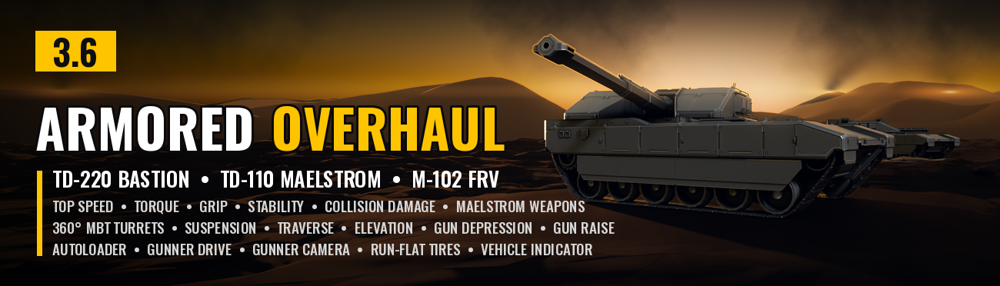
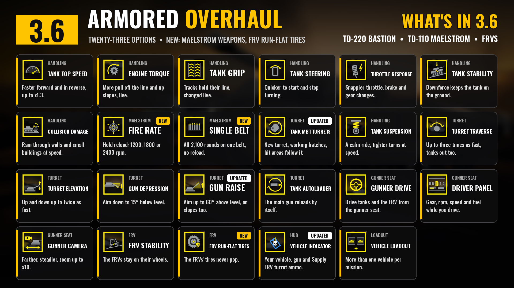
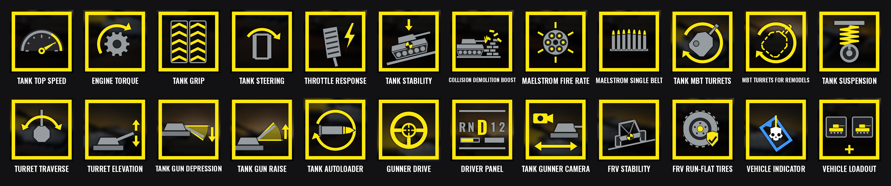
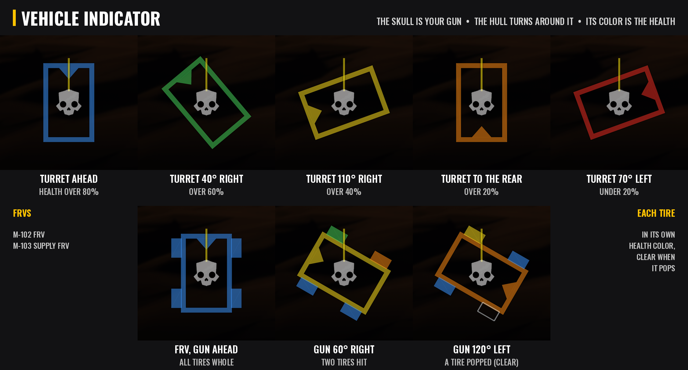

# Armored Overhaul



*A full vehicle overhaul for the TD-220 Bastion, TD-110 Maelstrom and the FRVs in Helldivers 2: handling, turrets, weapons, gunner-seat driving, cameras and a vehicle HUD, each part its own option.*

Armored Overhaul makes the Bastion and Maelstrom feel like real main battle tanks and keeps the FRVs on their wheels. Every part is its own option, so you pick what you want in your mod manager, and with the Mod Options Menu you can change them in game too.



## Features

- **Tank Top Speed:** more engine speed and pulling power, so the tanks reach a higher top speed and accelerate quicker, forward and in reverse. Pick *Fast* (x1.1), *Faster* (x1.15) or *Fastest* (x1.3); the game's tanks top out at about 35 km/h on the flat. It changes the tank you are in at once, in any seat, and the extra pull never tips the hull back more than the game's own. In the Mod Options Menu a change reaches every tank the mod has changed, and Off puts the tank's own engine back.
- **Tank Engine Torque:** more engine torque, so the tanks get off the line, up slopes and through rough ground quicker. Pick *Strong* (x1.2), *Stronger* (x1.35) or *Strongest* (x1.5). Top speed stays the game's own unless Tank Top Speed is on too (then their torque boosts multiply), and the extra pull never tips the hull back more than the game's own. It changes the tank you are in at once.
- **Tank Grip:** more track grip, so the tanks hold their line on slopes and in turns instead of sliding. Pick *Moderate* (x1.2), *Strong* (x1.35) or *Maximum* (x1.5). It changes the tank you are in at once.
- **Tank Steering:** quicker steering response: the tanks start and stop turning sooner. Pick *Responsive* (1.25 times the game's), *Quick* (1.5 times) or *Sharp* (twice). It changes every tank at once.
- **Tank Throttle Response:** snappier tanks: the throttle and brake let go sooner when you release the keys, and gear changes and switching between forward and reverse wait less. Pick *Quick* (they let go twice as fast; half the pause when changing gear or direction), *Quicker* (four times as fast; a fifth of the pause) or *Instant* (at once; no pause). It changes the tanks at once.
- **Tank Stability:** keeps the tanks flat on the ground. Downforce presses the tank down harder the faster it goes, so it stays on the ground over crests, ramps and bumps instead of floating. Pick *Stable*, *Steady* or *Planted*: the tank weighs 1.5 times, twice or three times as much at 45 km/h (about half that extra at 32 km/h, little at walking pace). It pushes through the tank's center, so it doesn't lean the hull. It changes the tank you are in at once.
- **Tank Collision Damage Boost:** the faster the Bastion and Maelstrom drive into things, the harder they hit, so walls, fences and small buildings break when you ram them at speed instead of stopping the tank dead. The game gives a tank the demolition force of a car (25 when slow, up to 35); this option sets it from how fast the tank is really going: 30 when crawling, 35 at half speed (about 17 km/h) and 40 from three-quarter speed (about 26 km/h) up. It never goes above 40, so it can't be used to cheese objectives that need more, and a nudge still won't break a wall. After a hit the higher value is kept for a quarter of a second, so it counts in the frames the tank stops. It's one checkbox in the mod manager, with an on/off switch in the Mod Options Menu (on by default). It only runs while you drive a tank (the driver seat, or the gunner seat with Gunner Drive) and follows only the tank you drive; on foot nothing runs and the tanks keep the crawling value. Turning it off puts the game's own back. Both tanks of the same kind share the game's setting; in multiplayer it most likely only takes effect when you host.
- **Maelstrom Fire Rate:** hold reload in the Maelstrom's gunner seat to switch its main gun's fire rate on the fly, like other weapons with fire-rate settings: 1200 (the game's), 1800 or 2400 rounds a minute. The gun starts at 1800; pick with right click. While the menu is open neither the gun nor the missiles fire, so a click there only picks a rate, and the rate you picked pops up next to the gun's ammo bar as the menu closes (for example "2400 RPM", then it fades). The menu is titled Maelstrom. A change in the Mod Options Menu reaches the next Maelstrom called in (one already out keeps what it was called in with).
- **Maelstrom Single Belt:** the Maelstrom's main gun carries all its ammo on one belt: 2,100 rounds instead of 300, and it never reloads (a tap of reload does nothing; hold it for the fire-rate choice when Maelstrom Fire Rate is on). A change in the Mod Options Menu reaches the next Maelstrom called in.
- **Tank MBT Turrets:** the gun turns all the way round, or 90 degrees either side, and the whole top of the tank turns with it like a real main battle tank turret. The turret is the tank's own armor, cut level just above the hull's roof line and turned with the gun, so it wears your camo and shows battle damage like the rest of the tank, and the gunner view turns with it. Its walls come straight down, rounded in at the bottom, and end a small gap above the deck with a recessed turret ring showing in the gap, like a real main battle tank turret. The turret is closed all round, the hull's own plating (with your camo) shows under it, and its shadow follows it. The hatches work: they open and close like the game's own and go round with the turret, and the gunner's door at the back of the turret swings up and out on its top edge. The gunner gets in and out at the turret's door wherever the turret points, and the passengers' places and the ways in go round with the turret too. The turret's hit areas (its five armor plates, its core, the side and rear boxes, radar and antenna) turn and move with the turret, so a shot on the turret hits the turret. On the Maelstrom the game's own missile pods and smoke launcher turn with the turret (with the turret centered the pods ride a little higher, so they don't sink into the hull), and the Bastion's second gun and the Maelstrom's laser designator point where the main gun does (the designator is locked to its mount and aims from 60 degrees below level up to as high as the view). Pick *360 (all the way round)* or *180 (90 each side)*; with 180 the gunner view stops where the gun does. With the Mod Options Menu, **Tank Turret Position** can move the turret to the middle of the hull like a real main battle tank (*Centered*), so the gun reaches past the front deck and clips less when aimed low; the hull's own plating shows where the turret used to sit. *Original*, the game's place, is the default, and a change shows at once, hit areas included.
- **Tank Suspension:** longer road wheel travel, so the wheels drop into dips and the tracks stay on the ground, with firmer damping that settles the hull quickly after rocks and bumps. The tanks ride 0.1 m higher than the game's for more ground clearance, and a lower center of gravity makes them hard to tip. They keep their full steering angle up to a slightly higher speed, for tighter turns when driving fast, and the hull's turning is damped so a lean builds more slowly: fewer rollovers in fast turns. Pick *Balanced* (half a meter of travel; the center of gravity as high off the ground as the game's; light turn damping) or *Planted* (a little less travel, slightly firmer springs, more damping, the lowest center of gravity and firmer turn damping: the calmest ride). Tanks called in after a change use it. It works together with MBT Turrets: its physics files carry the same turret hit areas.
- **Tank Turret Traverse:** how fast the turret turns side to side, and the gunner view with it. Pick *Quick* (1.5 times the game's 25 degrees a second), *Fast* (twice) or *Very fast* (three times, 75 degrees a second). With MBT Turrets all the way round the turret really reaches these speeds (past the game's own limit of about 46 degrees a second). Works with or without MBT Turrets. Like Elevation, Gun Depression and Gun Raise, a change in the Mod Options Menu reaches the tanks already out at once.
- **Tank Turret Elevation:** how fast the gun moves up and down, and the gunner view with it. Pick *Quick* (1.25 times the game's 35 degrees a second), *Fast* (1.5 times) or *Very fast* (twice).
- **Tank Gun Depression:** how far down the gun aims, and the gunner view follows. Pick *Low* (6 degrees below level), *Lower* (10 below) or *Lowest* (15 below); the game's own is 3 below. The gunner view goes 20 degrees below the gun's lowest angle, so on slopes the camera doesn't stop the barrel short of its range (with MBT Turrets it looks down to 80 degrees below the hull). With MBT Turrets the gun's up/down range also follows the slope under the turret, so turned back up a steep hill the gun still aims down the slope. How far up the gun aims stays the game's own unless Tank Gun Raise is on too.
- **Tank Gun Raise:** how far up the gun aims, and the gunner view follows. Pick *High* (30 degrees above level), *Higher* (45 above) or *Highest* (60 above); the game's own is 25 above. The gunner view goes 15 degrees above the gun's highest angle, never above 60, so on *Highest* it stops at the gun's own top. With MBT Turrets, on a slope the gun's and the view's top stops rise by how far the ground under the turret falls away, so aiming up over the low side of a leaning tank reaches as high as on flat ground. How far down the gun aims stays the game's own unless Tank Gun Depression is on too.
- **Freelook:** with CowboyBingus's Mod Bindings Menu, set a key for **Tank Turret: Freelook** (controls, tab MODS, section ARMORED OVERHAUL) and look around from the gunner seat while the gun stays where it points, left/right and up/down; let go and the turret turns to where you look. The trigger you pick for the key in the controls decides how it works: *Hold* = while you hold it, *Press*, *Double tap* or *Long press* = on, and off the next time. It comes with the turret options (MBT Turrets, Traverse, Elevation, Gun Depression, Gun Raise) and needs the Vehicle Indicator or Tank Gunner Camera on, which measure where the gun points.
- **Tank Autoloader:** the Bastion's and Maelstrom's main gun reloads by itself when it runs dry, in the game's normal reload time (perks count). You can still reload by hand.
- **Gunner Drive:** drive from the gunner seat when nobody is in the driver seat, in the tanks, the M-102 FRV or both. You stay the gunner: the gun, its HUD and camera work as normal while your movement keys drive, and the engine starts the game's own way when you set off. When a teammate gets in the driver seat, they take over, and if you get out while the vehicle rolls it brakes to a stop (so you aren't thrown by the moving tank). **Shift** and **CTRL** change gear and **Space** is the handbrake, as in the driver seat. **F** sounds the horn, and in the Maelstrom **Mouse 3** pops the smoke screen. On a controller the **left stick** drives (push it forward to drive forward, back to reverse, left and right to steer, even on the spot), its **click** sounds the horn and the **right stick click** pops smoke. With CowboyBingus's **Mod Bindings Menu** you can set your own keys for Forward, Back, Handbrake, Horn and Smoke (steering and gears are always the game's own controls) (controls, tab MODS, section ARMORED OVERHAUL). A control you set a key for no longer answers its built-in key, so the two can't fight; the controller's left stick still drives. On a controller the triggers fire the guns and no longer move the tank.
- **Driver Panel:** while you drive from the gunner seat with Gunner Drive, a panel like the game's own driver HUD shows the gear selector, the gear, an rpm bar, your speed, a fuel bar and the Maelstrom's smoke rounds left, in the game's own HUD font. It only shows while you are the one driving (not while another player's game controls the vehicle), and it can be turned off in game with the Mod Options Menu. Only you see it.
- **Tank Gunner Camera:** the gunner camera sits lower and further behind the turret than the game's, 1.4 m above it at every distance, so you see more of the tank and around it. It circles the turret along your view, smoothly even at high traverse. Going uphill the view stays level; pointing downhill it follows the slope and rises with the hill behind it, so you can see the ground ahead and the turret doesn't block the view. Aiming up, and with the tank leaning to the side, it rises over the turret too, so it never sinks between the Maelstrom's missile pods. Pick *Close* (about 1.5 m back), *Far* (about 3.5 m), *Farther* (about 5 m) or *Farthest* (about 6.5 m): that is where the camera starts each time you sit down. In the gunner seat the **mouse wheel** moves it closer or farther back, 1 m a notch, and from the closest point zooms in on the crosshair one step a notch: x2, x3 and so on up to x10 (a small "x3" next to the crosshair shows the zoom for a moment). Zoomed in, the view doesn't shake with the gun's recoil and keeps following the tank. The zoom also works in the **M-102 FRV's gunner seat** and on the **HMG and Anti-Tank Emplacements**: the wheel moves the camera back when you're not aiming, and zooms on the crosshair up to x10 while aiming. With the Mod Bindings Menu you can also set Zoom In / Zoom Out keys, on a controller too; a key set for one of them turns that direction of the mouse wheel off. While the pause menu or the map is open, the wheel and the zoom keys leave the camera alone, in all of these seats. Getting out puts the view back.
- **FRV Stability:** the M-102 FRV, M-103 Supply FRV and M-104 incendiary FRV stay on their wheels over rough ground, jumps and hard turns: a firmer front, firmer damping, a lower center of mass, more tire grip and weight, and a little more ground clearance. Pick *Stable* (the default), *Mild* or *Planted*. Engine and steering stay the game's own.
- **FRV Run-Flat Tires:** the M-102 FRV's and M-103 Supply FRV's tires never pop or lose health, so you keep driving on all four wheels (the Vehicle Indicator shows them full). It's one checkbox in the mod manager, with an on/off switch in the Mod Options Menu. In multiplayer the host's game decides the damage, so it works when you host or play alone.
- **Vehicle Indicator:** a small outline of your vehicle on screen shows which way the gun points compared to the hull, like a real tank's display, in any seat of the Bastion, the Maelstrom, the M-102 FRV and the M-103 Supply FRV. The Helldivers skull is the turret and always points up, and the hull turns around it. The outline's color is the vehicle's health: blue, then green, yellow, orange and red as it takes damage. On the FRVs each tire shows its own health and goes clear when it pops, and in the M-103 Supply FRV a bar beside the outline shows its automated turret's ammo (yellow, orange when low, red outlines when it's out). With the Driver Panel it sits just left of the panel, and in the driver's seat of any vehicle it sits in that same place. Only you see it.
- **Vehicle Loadout:** pick more than one tank, exosuit or FRV in your stratagem loadout. The game normally swaps your earlier vehicle out when you pick a second one; with Vehicle Loadout you can take, say, a Bastion and a Maelstrom, or two exosuits, into the same mission. Each still has its own cooldown and uses. It works when you host and when you join, and turning it off in the Mod Options Menu puts the game's limit back at once.



## Options (Arsenal / HD2 Mod Manager)
Each option and each of its choices has its own icon in the mod manager, in this order. Turn an option off to keep the game's own.

- **Tank Top Speed** - *Fast*, *Faster* or *Fastest*.
- **Tank Engine Torque** - *Strong*, *Stronger* or *Strongest*.
- **Tank Grip** - *Moderate*, *Strong* or *Maximum*.
- **Tank Steering** - *Responsive*, *Quick* or *Sharp*.
- **Tank Throttle Response** - *Quick*, *Quicker* or *Instant*.
- **Tank Stability** - *Stable*, *Steady* or *Planted*.
- **Tank Collision Damage Boost** - the tanks break walls, fences and small buildings when they ram them at speed.
- **Maelstrom Fire Rate** - hold reload to switch between 1200, 1800 and 2400 rpm.
- **Maelstrom Single Belt** - all 2,100 rounds on one belt, no reload.
- **Tank MBT Turrets** - *360 (all the way round)* or *180 (90 each side)*.
- **Tank Suspension** - *Balanced* or *Planted*.
- **Tank Turret Traverse** - *Quick*, *Fast* or *Very fast*.
- **Tank Turret Elevation** - *Quick*, *Fast* or *Very fast*.
- **Tank Gun Depression** - *Low*, *Lower* or *Lowest* (6, 10 or 15 degrees below level).
- **Tank Gun Raise** - *High*, *Higher* or *Highest* (30, 45 or 60 degrees above level).
- **Tank Autoloader** - the main gun reloads by itself.
- **Gunner Drive** - *Tanks and FRV*, *Tanks* or *FRV*.
- **Driver Panel** - the gear, rpm, speed and fuel while you drive from the gunner seat.
- **Tank Gunner Camera** - *Close (about 1.5 m back)*, *Far (about 3.5 m back)*, *Farther (about 5 m back)* or *Farthest (about 6.5 m back)*.
- **FRV Stability** - *Stable*, *Mild* or *Planted*.
- **FRV Run-Flat Tires** - the FRVs' tires never pop.
- **Vehicle Indicator** - the gun direction and health display.
- **Vehicle Loadout** - more than one tank, exosuit or FRV in your loadout.



## Mod Options Menu (optional)
With CowboyBingus's **Mod Options Menu** installed, the options you installed also show in the game's options under MODS, ARMORED OVERHAUL, in the same order and with the same choices, plus Off. Each starts at what you picked in your mod manager; Tank Collision Damage Boost, the two Maelstrom options and FRV Run-Flat Tires are on/off switches, on by default. Tank Turret Position is set here only (with MBT Turrets). Changes take effect at once: the Top Speed, Engine Torque, Grip, Steering, Throttle Response and Stability rows change the tanks mid-mission, the Collision Damage Boost and FRV Run-Flat Tires switches take effect at once, Maelstrom Fire Rate and Single Belt reach the next Maelstrom called in, and Turret Traverse, Elevation, Gun Depression and Gun Raise (one row each, with Off and their three steps) reach the tanks already out. Only a new gunner camera distance, and the gunner view's new look speed and limits, wait for the next time you take the gunner seat. Tank Suspension and FRV Stability change the vehicles' own files, so they are picked in the mod manager only. Without the menu, everything works as picked in the mod manager.

## Requirements
- [Bingus Shared Loader](https://www.nexusmods.com/helldivers2/mods/16292) v19 or newer, last in the load order. Every option except Tank Suspension and FRV Stability needs it.
- Optional: CowboyBingus's Mod Options Menu, to change the options in game.
- Optional: CowboyBingus's Mod Bindings Menu, to set your own Gunner Drive and gunner zoom keys, and the Freelook key.

## Download

Get the latest zip from the [Releases page](../../releases) (the Armored-Overhaul-<version>.zip file, not the source code). The mod is also on [AyakaMods](https://ayakamods.com).

## Install / update

1. Install Bingus Shared Loader v19 or newer.
2. Add Armored-Overhaul-3.6.1.zip in Arsenal or the HD2 Mod Manager and check the options you want.
3. Purge & Deploy, then restart the game.

Updating from 3.6.0: install it over 3.6.0, then Purge & Deploy and restart the game. Your options stay as they are.

Updating from 3.5: install it over any 3.5 version, tick the new Maelstrom Fire Rate, Maelstrom Single Belt and FRV Run-Flat Tires options if you want them, then Purge & Deploy and restart the game. Your other options stay as they are.

Updating from 3.4: install it over 3.4.0. **Tank Turret Aim Range is gone: pick Tank Gun Depression and/or Tank Gun Raise instead** (its 3.4.0 Mod Options Menu value doesn't carry over). Tick the new Tank Collision Damage Boost option if you want it. Tank Suspension moved below Tank MBT Turrets in the list (your pick stays). Check your other options are still as you had them (your mod manager may set them back to the first choice when it imports the update). Purge & Deploy.

Updating from 3.3: as from 3.4, and also **check your Tank Engine Torque and Tank Gunner Camera picks** (Tank Power is now Tank Engine Torque, and the Gunner Camera choices were renamed). Engine Torque's and Grip's strongest choices are now x1.5 (were x2). Tick the new Tank Top Speed, Tank Throttle Response and Tank Stability options if you want them. Purge & Deploy.

Updating from 3.2: as from 3.3, and also update Bingus Shared Loader to v19 or newer and tick the Vehicle Loadout option (new in 3.3.0) if you want it. Purge & Deploy.

Updating from 3.1: install it over 3.1.1 (or 3.1.0) and **tick the new Driver Panel option** to keep the driver panel (it was part of Gunner Drive), then check your other options are still as you had them (your mod manager may set them back to the first choice when it imports the update). Purge & Deploy.

Updating from 3.0: install it over 3.0.1 (or 3.0.0), then look over your options (your mod manager may set them back to the first choice when it imports the update). Tank Turret Traverse's speeds changed, so pick it again, and FRV Stability now lists *Stable* first. From 3.0.0, Tank Suspension's *Firm* and *Heavy* are now *Balanced* and *Planted*: pick one again.

Updating from 2.0: install it over 2.0.1, then look over your options: several were renamed (they now start with "Tank", and the Turret indicator is now the Vehicle Indicator), Gunner Drive now lets you pick the tanks, the FRV or both, and Tank Autoloader is new. The Vehicle Indicator and driver panel no longer use settings files: *ArmoredOverhaul-TurretIndicator.cfg* and *ArmoredOverhaul-DriverPanel.cfg* in the Bingus logs folder are no longer read and can be deleted.

## Uninstall
Remove it in your mod manager, then Purge & Deploy. Nothing is left behind in the game; its logs stay in the Bingus logs folder and can be deleted.

## Compatibility

- Don't combine it with other mods that change the Bastion or Maelstrom turrets, models, physics files, handling or suspension (for example casemate or traverse turret mods, tank model replacers or tank reskins that replace the hull models), or with other drive-from-the-gunner-seat or gunner camera mods. Turn off the matching option instead if you want to keep another mod. If another mod keeps changing the same tank or camera values back, Armored Overhaul leaves them to it and says so in its log.
- FRV Stability changes the same files as other FRV handling mods; use one or the other.
- The exosuits themselves are not changed; Vehicle Loadout only lets you pick more than one.
- Vehicle Loadout and other mods that change the stratagem loadout limits may not mix; turn one of them off.
- Tank Collision Damage Boost and other mods that change the tanks' demolition force may not mix; turn one of them off.
- The Maelstrom options and other mods or stat editors that change the Maelstrom's weapons may not mix; turn one of them off.
- FRV Run-Flat Tires and other mods that change the FRVs' health may not mix; turn one of them off.
- Made and tested on the September 2026 game version.

## Known limitations

- Only you see the turning turrets and the Vehicle Indicator; other players see the normal tanks.
- The tank's body (what you stand on and what the tank drives into) is still the game's own shape, whose top is the old turret's roof: with the turret centered or turned you can stand at roof height where the old turret was, in thin air. (The hit areas follow the turret; this is separate.)
- The M-104 incendiary FRV isn't in the game right now, so Gunner Drive and the Vehicle Indicator don't cover it yet (FRV Stability does).
- Gunner Drive only works while nobody is in the driver seat. In multiplayer, the player who drove a vehicle last keeps control of it after getting out, so Gunner Drive can't move it (the driver panel stays hidden then). Take the driver seat once, then go back to the gunner seat, and it's yours again.
- In a tank another player called in, the gunner-seat smoke key does nothing for now (it no longer fires the wrong launcher or shows the wrong count).
- Tank Suspension still needs the tank to be called in again after a change (it's in the tank's physics file); every other tank option changes mid-game.
- Tank Collision Damage Boost: both tanks of the same kind share the game's setting, so while you drive fast a teammate's tank of the same kind gets it too, and in multiplayer it most likely only takes effect when you host.
- Maelstrom Fire Rate and Single Belt: a Maelstrom takes them when it's called in, so a change in the Mod Options Menu reaches the next one (and turning Single Belt on while a Maelstrom with belts is out can show an odd count on that tank after it reloads).
- Maelstrom Fire Rate: the game draws the fire-rate list over the gun's ammo bar; where it goes can't be changed.
- Maelstrom Fire Rate with a controller: the guns can still fire while the fire-rate menu is open, and the new rate pops up once you fire (the menu is followed through the keyboard key that opened it).
- Freelook in multiplayer: the game keeps one setting for both tanks' main guns, so while you hold Freelook as the host, another player's turret may stop turning too. Tell me if you see it.
- After a game update, the script options find what they need again by themselves. If an update changes the vehicles' own models or physics, Tank MBT Turrets, Tank Suspension and FRV Stability need an update from me, and I check this after every game patch.

## How it works

- **Tank Top Speed, Tank Engine Torque, Tank Grip and Tank Stability:** a Lua addon changes the tank's engine speed and torque, track grip and downforce live, on the tank you sit in, through the game's own vehicle physics calls (the ones it makes when it sets a tank up); Tank Throttle Response's gear-change pause is set the same way.
- **Tank Steering and Tank Throttle Response:** a Lua addon scales the tanks' steering rate and their throttle and brake let-off rates in the game's own vehicle settings, which the game reads every frame.
- **Tank Suspension and FRV Stability:** changed spring, damping, suspension travel, wheel mounts, grip, wheel size, mass and center of mass values in the vehicles' own physics files; Tank Suspension also raises the speed up to which the tanks keep their full steering angle and damps the hull's turning.
- **Tank Collision Damage Boost:** a Lua addon sets the two tanks' demolition force in the game's loaded vehicle collision settings from how fast the tank you drive is going, and puts the game's own values back when it is turned off or the game closes.
- **Tank MBT Turrets, Traverse, Elevation, Gun Depression and Gun Raise:** one shared Lua addon changes the guns' turn limits, turn speeds and how far down and up they aim in the game's own turret settings; MBT Turrets uses the game's own tank hulls with everything above the roof line tied to the turret's mount, and turns that mount with the gun every frame, with the hatches and the ways in going round with it; Turret Position moves that mount forward. Freelook holds the gun by setting its turn limits to where it points while the key is on. MBT Turrets now also ships the tanks' physics files, with the turret's hit areas tied to the same mount so they turn and move with the turret (with Tank Suspension on too, its physics files carry the same hit areas).
- **Maelstrom Fire Rate and Single Belt:** a Lua addon finds the game's weapon settings tables in memory (by their layout, never by fixed addresses) and changes the Maelstrom main gun's own records in them: its three fire rates and the fire-rate function on the right mouse button (the same function the FRV's gun has), and its belt and spare belts. The fire-rate menu's title comes from the Maelstrom's own name. While that menu is open, Tank Core names nobody as the gun's and missile pods' operator (the game only fires a weapon for its operator) and puts you back as it closes; it also reads the rate you picked from the game then, for the pop-up. Every value is checked every few seconds, and turning an option off puts the game's own back.
- **FRV Run-Flat Tires:** a Lua addon marks the FRVs' four tire zones as unbreakable in the game's own health settings (the same flag the game uses for parts that can't be destroyed), and the seat reader keeps the tires of the FRV you ride in full. The game's own flags come back when it's turned off or the game closes.
- **Tank Autoloader:** when the main gun's magazine runs dry, it asks the game to start the reload, the same way the reload key does.
- **Gunner Drive:** a Lua addon copies your movement keys (or your left stick) into the vehicle's driver controls while the driver seat is empty, the same way the game does for a real driver, and starts the engine with the game's own engine switch. The horn and the smoke key use the game's own horn and the Maelstrom's own smoke launcher.
- **Driver Panel:** a Lua addon reads the gear, rpm and fuel from the vehicle, measures your speed from how far it moves, and writes them with the game's own HUD font.
- **Tank Gunner Camera:** a Lua addon sets the camera's height and its distances behind the turret in the game's own gunner camera settings, and the game circles the camera round the turret along your view. The crosshair zoom narrows the camera's own field of view setting, the way the game's scope views do, in the tank, the FRV gunner seat and on the emplacements.
- **Vehicle Loadout:** a Lua addon clears the "pick only one" mark the game puts on the vehicle stratagems in its stratagem list, so the loadout screen no longer swaps them out, and puts it back when turned off or when the game closes. Calling in, cooldowns and uses stay the game's own.
- **Vehicle Indicator:** a Lua addon reads the turret's angle and the vehicle's health (and the FRV's tires, and the Supply FRV turret's ammo) the way the game's own driver HUD does, and draws the outline with the game's own on-screen drawing. The skull is a copy of the game's own Helldivers skull icon.

Everything is written from scratch and built from the game's own files. No DLLs are added and no game code is patched.

## Troubleshooting
Attach the logs to your bug report: *ArmoredOverhaul-TankSpeed.log* (Tank Top Speed), *ArmoredOverhaul-TankPower.log* (Tank Engine Torque), *ArmoredOverhaul-TankHandling.log* (Tank Grip), *ArmoredOverhaul-TankSteering.log*, *ArmoredOverhaul-TankThrottle.log* and *ArmoredOverhaul-TankShift.log* (Tank Throttle Response), *ArmoredOverhaul-TankStability.log*, *ArmoredOverhaul-CollisionDamage.log* (Tank Collision Damage Boost), *ArmoredOverhaul-MaelstromWeapons.log* (the two Maelstrom options), *ArmoredOverhaul-RunFlat.log* (FRV Run-Flat Tires), *ArmoredOverhaul-MBTTurrets.log* (all the turret options), *ArmoredOverhaul-TurretModels.log* (the turning MBT turrets), *ArmoredOverhaul-GunnerDrive.log* (Gunner Drive, Tank Autoloader and the seat reader), *ArmoredOverhaul-DriverPanel.log*, *ArmoredOverhaul-GunnerCamera.log* and *ArmoredOverhaul-TurretIndicator.log* (Vehicle Indicator) and *ArmoredOverhaul-VehicleLoadout.log*. You'll find them in `%LOCALAPPDATA%\CowboyBingus\Helldivers2\Logs` (type %LOCALAPPDATA% into the File Explorer address bar and press Enter). They show the game version, what each option found and changed, the choice in use, whether the Mod Options Menu was found, and any errors.

- **No "Tank Turret: Freelook" key in the controls (tab MODS):** the Mod Bindings Menu has 29 key slots shared by every mod, and a mod you removed keeps its slots for 30 game sessions. Armored Overhaul takes 8 (Freelook first). Update the Mod Bindings Menu, Purge & Deploy and restart the game; if it's still missing, send *ModBindingsMenu.log* with the Armored Overhaul logs.

## Building from source

Each option's Lua addon is in `src/lua/` exactly as it ships; `src/build.py` (Python 3, no other packages) packs them into Helldivers 2 patch archives and writes the Arsenal / HD2 Mod Manager zip to `src/build/`, with the manifest, thumbnail and option icons.

The Tank MBT Turrets models, the Tank Suspension and FRV Stability presets and the turret skull are made from the game's own files, so they aren't stored here. Take them from the release zip first:

```
cd src
python tools/unpack_release.py Armored-Overhaul-3.6.1.zip
python build.py --check Armored-Overhaul-3.6.1.zip
```

`--check` compares the zip it makes with the release zip, file by file (all 249 files are the same, byte for byte). `src_physics/` holds the scripts that make the suspension and FRV presets and the turret hit areas from the game's physics files, `src_models/` the scripts that rebuild the two tank hulls for the turning turrets, and `src/art/` how the pictures are made.

## Support

All my mods are free and always will be. Every release is rigorously tested in real missions, highly optimized and kept working through game updates. If you'd like to help me keep that up and build new mods, you can support me on [Patreon](https://www.patreon.com/c/Chefboiardee).

Thank you for diving with me!

## Credits
- **CowboyBingus** - Bingus Shared Loader, the Mod Options Menu and the Mod Bindings Menu.
- **Filediver** and **HD2SDK** (Blender add-on) - the tools used to read the game's models and build the turrets.
- **HD2 HUD+** - showed how to draw on screen and use the game's own HUD font from a Lua addon.

## Changelog

See [CHANGELOG.md](CHANGELOG.md).

## License

Copyright (c) 2026 Th3chef. All rights reserved. You're welcome to read the source, report bugs and suggest fixes, but please ask before reusing it or reuploading the mod. See [LICENSE](LICENSE).
